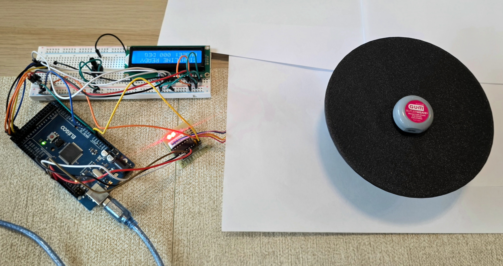

# SIGHTLINE

SIGHTLINE is an ongoing research project about a simple part of object recognition: choosing what to look at. I built a motorized turntable and camera setup to test whether a vision-language model can use the views it has already seen to choose a useful next angle.

The project is currently in prototype testing. I have paused new collection while I work on turntable repeatability, camera consistency, and how recognition should be scored. The examples here are early observations, not results from a completed study.



*Prototype setup: Arduino Mega, motor driver, LCD, and turntable.*

## Research question

The idea started with a limitation of single-image recognition. A model might see enough to recognize an earbud case or a toy car, but not enough to distinguish the exact product. A logo could be on the other side. Two devices could look similar from the front but have different connectors at the back. The missing information may simply be outside the photograph.

I wanted to investigate the choice of image itself. Instead of giving a model a fixed set of photographs, could I let it look at the object and decide what it needed to see next? A turntable offered a practical way to test that: keep the camera in place, rotate the object, and let the model choose the next angle. This led to the research question:

**Can AI-guided viewpoint selection improve fine-grained object recognition accuracy and image efficiency compared with uniform and random scanning, within individual models and across different models?**

The purpose is to find out when this helps and when it fails. Some objects may be identifiable from one image. Extra views might reveal a useful marking, add very little, or cause a model to change a correct interpretation. I want to compare the benefit of those views without retraining or fine-tuning the models.

## How it works

A 28BYJ-48 stepper motor rotates an approximately 150 mm 3D-printed platform while the camera stays fixed. An Arduino Mega controls the motor through a ULN2003 driver. The LCD displays the current operation and commanded angle. A Samsung Galaxy S25 Ultra provides the camera feed through Plugcam.

The [Streamlit dashboard](dashboard.py) coordinates rotation and capture, sends images to the models, and saves photographs, predictions, selected angles, and API errors. Recognition can be run again from saved images without operating the turntable.

The [hardware and methodology notes](docs/methodology.md) include the wiring diagram, component roles, experiment design, and startup instructions.

## Models

| Model | Setup |
|---|---|
| Qwen3-VL-4B-Instruct | Runs locally through llama.cpp on my RTX 4060 laptop |
| Gemini 3.5 Flash Lite | Accessed through Google's API |
| NVIDIA Nemotron 3.5 Super VL | Accessed through NVIDIA's hosted API |

Cost and access influenced these choices. Qwen can run on my laptop, while the free API access available to me from Google and NVIDIA makes small tests with hosted models practical. I plan runs around each account's request allowances. Check [Google's limits](https://ai.google.dev/gemini-api/docs/rate-limits) and [NVIDIA's API access](https://docs.api.nvidia.com/nim/docs/product) for the current allowances.

Using different models also lets me compare how they interpret the same photographs and which views they choose. A model might recognize the category but miss the brand or exact variant. I want to understand whether useful viewpoints depend on the model selecting them.

## Experiment design

The intended comparison uses five photographs for each of five strategies: uniform, random, Qwen-guided, Gemini-guided, and NVIDIA-guided scanning.

Uniform scanning uses evenly spaced angles rounded to the turntable's 5° grid. Random scanning selects unused angles. In a guided scan, the model sees its own photographs so far and chooses the next angle.

Recognition uses the images cumulatively: the third checkpoint includes the first three photographs. Every checkpoint is a fresh request, without earlier answers or the registered object identity. Each model evaluates the uniform and random scans, along with its own guided scan.

Testing whether one model's selected views help another model is a separate comparison that I still need to add.

## Early observations

The example uses a Matchbox 2022 Infiniti QX80 toy car to show the images being captured and how the model responses change.

<a href="evidence/images/matchbox_2022_infiniti_qx80_uniform_20261109_122226_746eb5_view_05_290.jpg"></a>

*Matchbox Infiniti QX80 toy car on the turntable at 290°.*

The table follows the same uniform scan as each model received more photographs. A row with three photographs means the model saw views 1–3 together, not just the third image. The wording is taken from the [saved predictions](evidence/trials.csv).

| Photographs | Qwen | Gemini | NVIDIA |
|---:|---|---|---|
| 1 | silver SUV toy model | Toy SUV diecast model car | Toy model of a silver SUV |
| 2 | silver toy SUV | Infiniti QX80 diecast toy car | Infiniti QX60 toy car |
| 3 | silver toy SUV | Infiniti QX80 toy car | Infiniti QX80 toy car |
| 4 | silver toy SUV | Infiniti QX80 toy car | Infiniti QX60 die-cast model car |
| 5 | silver metallic SUV toy model | Infiniti QX80 toy car model | Infiniti QX60 toy car |

All three started with a general SUV description. Gemini named the QX80 after the second view and kept that identification. NVIDIA moved from QX60 to QX80, then back to QX60 as more images were added. Qwen stayed at the category level throughout.

That change is part of what I want to investigate. More photographs provide more evidence, but they do not guarantee a better prediction. Since these are fresh requests at each checkpoint, the sequence also does not establish that a model is remembering or defending an earlier answer. This example raises questions to test across more objects; it is not an accuracy ranking.

The saved viewpoint sequences also differ: some choices cover several sides, while others make small changes around nearby angles. These examples help identify what to investigate next, but they do not establish which strategy or model performs best.

## Running the prototype

The current setup uses Windows and Python 3.12. The camera module uses DirectShow.

```powershell
py -3.12 -m venv .venv
.\.venv\Scripts\python.exe -m pip install -r requirements.txt
$env:SIGHTLINE_PORT = "COM10"  # Set the Arduino's actual port
$env:GEMINI_API_KEY = "your-key"
$env:NVIDIA_API_KEY = "your-key"
.\.venv\Scripts\python.exe -m streamlit run dashboard.py
```

Start the local Qwen server in a separate terminal:

```powershell
llama-server -hf Qwen/Qwen3-VL-4B-Instruct-GGUF:Q4_K_M --alias Qwen3-VL-4B-Instruct --port 9931
```

The [startup instructions](docs/methodology.md#startup) cover firmware, power checks, camera selection, local model files, and recovery after an interruption. [.env.example](.env.example) lists the configuration variables; the app reads environment variables directly and does not load this file automatically.

## Next steps

The turntable has a slight wobble and no encoder, so its recorded angles are commands rather than independent measurements. I need to check its coupling, support, and return-to-zero repeatability before relying on repeated scans.

I also need to control focus, exposure, lighting, and object placement; settle on a consistent scoring rubric; and collect repeated trials with balanced method order. After those checks, I can compare recognition by image count and extend the evaluation to views selected by other models.

[MIT license](LICENSE).
