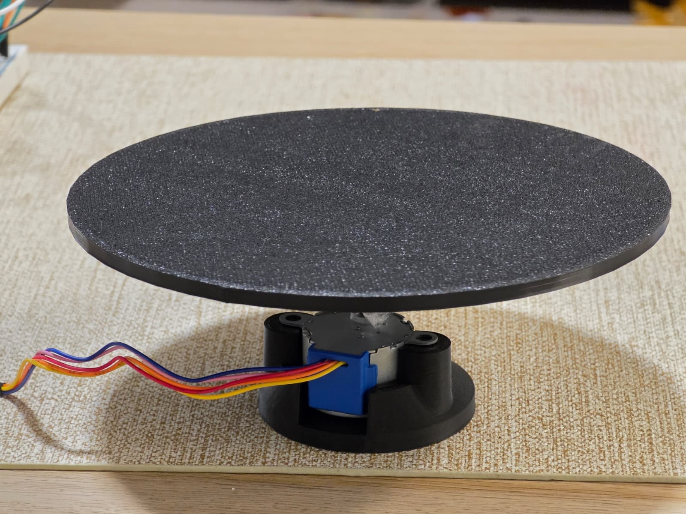
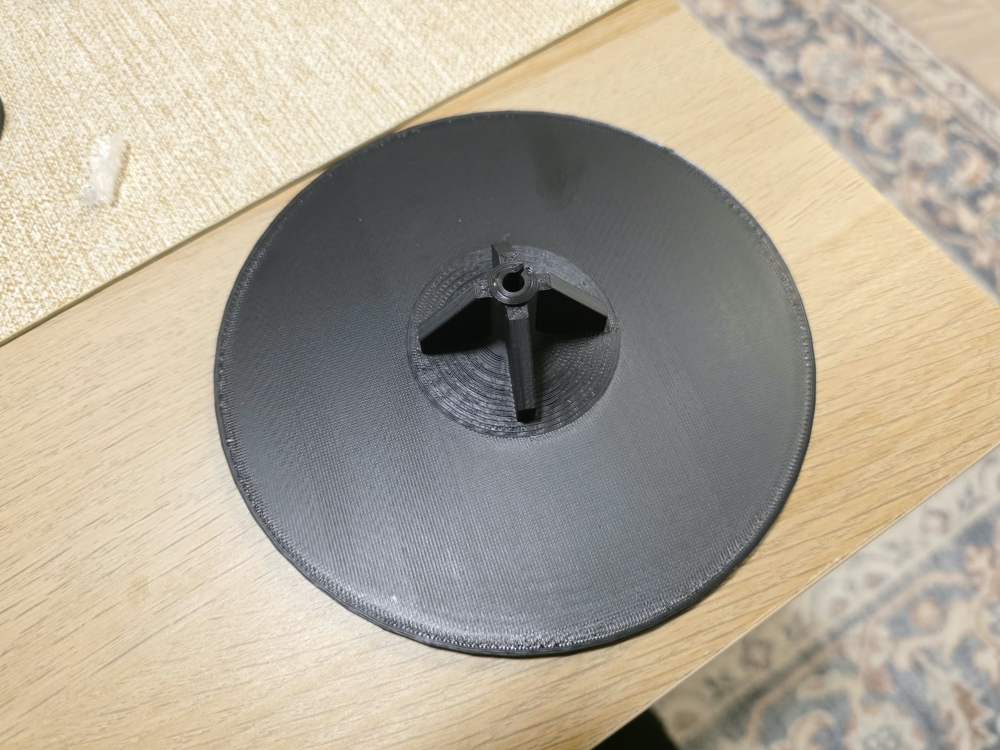
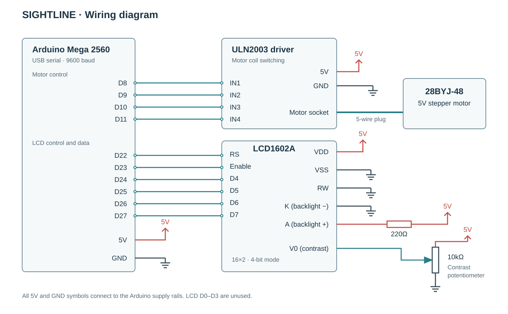
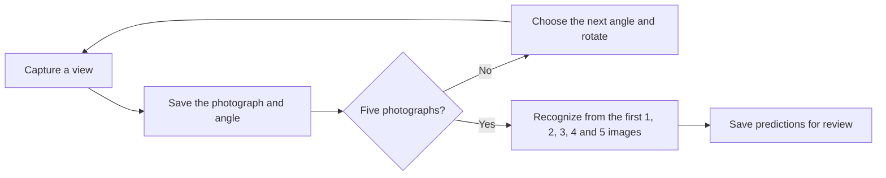

# Hardware and methodology

These notes describe the prototype and the procedure I am developing for comparing viewpoint selection methods. The current work is testing the setup and evaluation process before a controlled study.

## Circuit and mechanical setup

The Arduino receives rotation commands from the laptop over USB. It sends the stepping sequence to the ULN2003 driver, which switches the motor coils. The motor turns the printed platform while the phone camera stays in one position. Keeping the camera fixed makes it easier to compare views as the object rotates.

| Component | Role |
|---|---|
| ELEGOO Arduino Mega 2560 | Receives commands, controls the motor, and updates the display |
| 28BYJ-48 5V stepper motor | Rotates the platform in small increments |
| ULN2003 driver | Switches the motor coils from the Arduino's control signals |
| Printed platform and motor support | Holds the object above the motor and connects it to the shaft |
| LCD1602A 16×2 display | Shows status messages and the commanded angle |
| Contrast potentiometer | Adjusts the readability of the LCD |
| Breadboard and jumper wires | Connect the display, driver, and controller |
| Galaxy S25 Ultra through Plugcam | Supplies images to the laptop as a camera feed |



*Turntable mounted on the stepper motor and printed support.*



*Underside of the printed turntable and central shaft mount.*

### Wiring



*Motor driver and LCD wiring.*

| Component connection | Arduino connection |
|---|---|
| ULN2003 IN1 | D8 |
| ULN2003 IN2 | D9 |
| ULN2003 IN3 | D10 |
| ULN2003 IN4 | D11 |
| ULN2003 power | 5V and GND |
| Motor cable | ULN2003 motor socket |
| LCD RS / Enable | D22 / D23 |
| LCD D4 / D5 / D6 / D7 | D24 / D25 / D26 / D27 |
| LCD VDD / VSS | 5V / GND |
| LCD RW | GND |
| LCD V0 (contrast) | Wiper of a 10kΩ potentiometer; outer terminals to 5V and GND |
| LCD backlight anode / cathode | 5V through 220Ω / GND |

The Arduino's 5V and GND rails supply the driver and LCD in this build. The motor's coil current passes through the ULN2003 rather than the GPIO pins. The potentiometer adjusts LCD contrast, while the 220Ω resistor limits the backlight current. RW is grounded because the Arduino only writes to the display.

The Stepper library uses the constructor order `8, 10, 9, 11` to sequence the coils; the physical IN1–IN4 connections remain D8–D11. Serial communication runs at 9600 baud.

The [Cirkit Designer project](https://app.cirkitdesigner.com/project/d0be2c08-4723-48da-9a64-ce4ad795e4d4) provides the component layout. The diagram above shows the electrical connections without reproducing the physical breadboard arrangement.

The platform has a slight wobble. I have not measured its size or its effect on captured views. The firmware estimates rotation from motor steps, with no encoder to measure the actual angle. I need to check coupling alignment, support, and repeated returns to the same position. A reference marker on the platform would help measure these errors. A better coupling, bearing support, or encoder are possible later improvements.

## Scanning and recognition

Each strategy starts at a manually aligned 0° position and has a five-photo budget:

| Strategy | How the next angle is chosen |
|---|---|
| Uniform | Fixed sequence: `0°, 70°, 145°, 215°, 290°` |
| Random | Four unused angles sampled from the 5° grid after the initial 0° view; the seed is saved |
| Qwen-guided | Qwen chooses from the unused angles after seeing its scan so far |
| Gemini-guided | Gemini chooses from the unused angles after seeing its scan so far |
| NVIDIA-guided | Nemotron chooses from the unused angles after seeing its scan so far |



A guided model receives only its own scan's photographs and their angles. Object names, correct labels, and recognition answers are kept out of these requests. Recognition is run separately, using a new request for each cumulative image set.

Uniform and random images are evaluated by all three models. Each guided scan is currently evaluated by the model that selected its views. Evaluating those views with the other models will be a later experiment.


*Viewpoint sequences for the Matchbox Infiniti QX80 toy car. Five photographs per strategy; angles are turntable commands.*

The [example images and records](../evidence) allow the predictions and view choices to be inspected together. `captures.csv` lists photographs and angles, `trials.csv` contains predictions, and the two API logs retain individual recognition and selection attempts. `provenance.json` records image checksums and the changes made to prepare the example, such as removing metadata and making paths portable.

For comparison, I need to score category, brand, product family, and exact model separately. A general category can be right while a specific product name is wrong. Self-reported confidence is also separate from correctness. The dashboard's automatic name-matching score is a testing aid; I do not use it as final recognition accuracy.

Before formal collection, I need a consistent scoring rubric, verified object identities, repeated random scans, and balanced method order. The app currently shifts method order between objects, but this alone does not make a balanced experiment. Focus, exposure, lighting, framing, and placement also need to stay consistent. The first five checkpoints belong to the same scan, so they should not be counted as five independent experiments. Analysis should compare methods across objects and report uncertainty across repeated trials.

## Startup

### Arduino and camera

1. Inspect the motor mount, shaft connection, wiring, power supply, and common grounds with power disconnected.
2. Upload [Sightline_Controller.ino](../firmware/Sightline_Controller/Sightline_Controller.ino) with the Mega 2560 board selected. The sketch uses the Stepper and LiquidCrystal libraries.
3. Connect USB, check the LCD's ready message, and set `SIGHTLINE_PORT` to the Arduino's COM port before starting the dashboard. Close Serial Monitor so it does not hold the port open.
4. Connect the phone through Plugcam. Select its camera index in the dashboard; the original setup uses index 3, but this can change between computers or reconnects.
5. Check a preview capture before collecting a scan. The camera module requests 2560×1440, and the capture records store the saved image dimensions. Set focus, exposure, lighting, and framing on the camera; the app does not lock these settings.
6. Place the object securely and align the platform to the chosen 0° position. The Arduino resets its angle estimate to zero when it restarts, so it still needs physical alignment.

For a status-only serial check with an empty platform:

```python
from motor_controller import connect, set_status

port = connect()
try:
    set_status(port, "CHECK READY")
finally:
    port.close()
```

This updates the LCD without commanding a rotation. Opening the serial connection can reset the Arduino.

### Local model and dashboard

Use the Python environment and installation commands in the [README](../README.md#running-the-prototype). Start llama.cpp before selecting Qwen in the dashboard. Its endpoint is `http://127.0.0.1:9931/v1`.

The local Qwen setup uses `Qwen3VL-4B-Instruct-Q4_K_M.gguf` and the vision projector `mmproj-Qwen3VL-4B-Instruct-Q8_0.gguf` from [Qwen's GGUF repository](https://huggingface.co/Qwen/Qwen3-VL-4B-Instruct-GGUF). The README's `-hf` command downloads these when needed. To use an existing download directly:

```powershell
llama-server -m "path\to\Qwen3VL-4B-Instruct-Q4_K_M.gguf" --mmproj "path\to\mmproj-Qwen3VL-4B-Instruct-Q8_0.gguf" --alias Qwen3-VL-4B-Instruct --port 9931
```

The model names used by the application are:

```text
Qwen3-VL-4B-Instruct
gemini-3.5-flash-lite
nvidia/nemotron-3.5-super-vl-120b-a12b
```

Cloud access uses `GEMINI_API_KEY` and `NVIDIA_API_KEY`. Keep keys in the local environment. Selecting a cloud model sends the photographs to that provider.

Qwen and Gemini use temperature 0. NVIDIA uses temperature 0.6 and top_p 0.95, with thinking disabled. These settings differ and need to be considered when comparing repeated predictions. Images are prepared in memory at up to 2560×1440 with JPEG quality 90; the captured originals stay unchanged. The logs record model names, prompt versions, input checksums, response times, and available token usage. Keep the model files, runtime version, prompts, and settings fixed during a study.

### Saved data and interrupted runs

The dashboard has separate Testing and Research workspaces. I am using the system for prototype testing; the folder names do not imply that a formal study has been completed. Testing saves to `study_data/`, and Research saves to `final_study_data/`. Both are excluded from Git. Set `SIGHTLINE_DATA_ROOT` to use another directory containing those folders.

Photographs are saved under each workspace's `images/` folder. Keep them with `objects.json`, the CSV logs, `batches.jsonl`, and any `reviews.json` file. Back up the whole workspace before moving or correcting records.

Use **Evaluate & retry** to select saved trials and run missing or failed recognition requests. Successful results are skipped unless re-evaluation is explicitly selected in Testing. Re-evaluation saves a new result without replacing the earlier response. Use **Data & exports** to download results and logs, and **Review predictions** to record manual assessments.

After an interrupted scan, inspect the saved images and physically realign the platform before starting again. Motor scans do not resume automatically. If a move is not acknowledged, its final position is uncertain and the app stops further motion. Invalid guided choices are retried; Testing can use a marked coverage fallback, while Research stops the trial. Fallback views should be kept separate from model-selected views in analysis.

## Software checks

Run the offline checks with `python -m pytest -q`. They cover request construction, saved-image integrity, retries, resource cleanup, and failure handling. Test discovery is limited to `tests/` so older hardware and API scripts are not run by accident.

The firmware compiles for `arduino:avr:mega`. Software checks do not replace checking the circuit, camera, and actual rotation before a new session.
