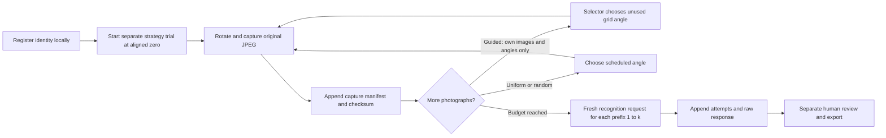

# Methodology and continuation

SIGHTLINE tests recognition from actively acquired views without fine-tuning the recognizers. This document records the implemented protocol, the limits of its evidence, and the steps needed to restart collection. The intended five-photo budget has not been presented as a preregistered study.

## From object registration to results



Registration stores ground truth and aliases locally. The active `call_vision` builds one fresh user request containing generic apparatus/task text and JPEG bytes. Neither filenames, object IDs, registered labels, other trials, prior recognition outputs, nor selector explanations are included. Recognition and selection are separate requests. This verifies request construction, not the absence of prior knowledge in pretrained models or providers' internal systems.

The 5° candidate grid is 0–355°. All strategies begin at 0°, but each captures its own starting photograph. Uniform uses `0,70,145,215,290`; random records its seed and samples four unused nonzero angles. Guided selectors see their own cumulative images with matching angles, selecting from unused candidates. Duplicate/invalid choices are rejected. Testing may use an explicitly logged maximum-coverage fallback after failure; Research stops instead. Never count fallback trials as successful AI-guided trials.

At five photographs there are 25 captures, 45 recognition checkpoints, and 12 successful selector calls per object, before retries. Each recognizer receives 15 recognition checkpoints plus four selection calls. Completing the planned 20-object run would therefore require 380 calls per model before retries. This is workload arithmetic, not an account-quota promise.

`models_for_method` implements owner-only recognition for current guided methods and all-model recognition for uniform/random. Historical `ai_guided` captures remain all-model evaluable for compatibility; that exception does not complete the current cross-model transfer design. Full current transfer would require 30 additional recognition checkpoints per complete object batch: each of three guided scans, five prefixes, two additional evaluators.

Research method order uses a stable object-ID hash to cyclically shift the five methods. This avoids one universal fixed order but does not ensure balanced counts, random order, or balanced carryover effects. Repeat trials of an object retain the same shift. Random repeats and explicit balancing remain necessary.

## Evidence and evaluation

The public excerpt is batch `d90c126192db`, registered as a Matchbox 2022 Infiniti QX80. It contains the five separate scans and their actual raw outputs, including model IDs, prompt version `sightline-recognition-v5`, selector version `sightline-view-selection-v5`, input fingerprints, latency, and available token counts. The exact product/SKU was not independently authenticated from packaging during this review.

Files under [evidence](../evidence) have precise roles:

| File | Meaning |
|---|---|
| `captures.csv` | 25 captured photographs, their commanded angles, dimensions, selection metadata and checksums |
| `trials.csv` | 45 raw cumulative recognition results; no accuracy labels added |
| `selector_calls.csv` | 12 retained selector responses and their inputs' fingerprints |
| `evaluation_attempts.csv` | 45 individual recognition attempts |
| `images/` | All 25 original-size photographs needed to inspect these scans |
| `provenance.json` | Private source-file/record digests, image digests before/after metadata removal, and exact derivative transformations |
| `inventory.json` | Aggregate inventory of the two private workspaces, with source-file digests |
| `photo-provenance.json` | Source digests and orientation changes for selected hardware photographs |

Only image paths and public-copy capture checksums were changed in the CSV excerpt. JPEG metadata was removed losslessly from experiment images: decoded pixels and compressed scan data are preserved. Source digests remain in provenance. Hardware photographs were re-encoded without EXIF; the assembly photo was rotated 90° counterclockwise. Originals remain private. Figures can be regenerated with `python tools/evidence.py figures`; no model is called.


*One retained Research batch, one trial per strategy, five photos per trial. Data: `evidence/captures.csv`. Values are commanded platform angles, not encoder measurements. Joined points indicate acquisition order, not continuous rotation paths. No recognition benefit can be inferred from angular coverage alone.*

For the **same uniform image prefix**, the recorded predictions include:

| Photos | Qwen | Gemini | NVIDIA |
|---:|---|---|---|
| 1 | silver SUV toy model | Toy SUV diecast model car | Toy model of a silver SUV |
| 3 | silver toy SUV | Infiniti QX80 toy car | Infiniti QX80 toy car |
| 5 | silver metallic SUV toy model | Infiniti QX80 toy car model | Infiniti QX60 toy car |

All nine predictions are traceable to the vehicle uniform trial in `trials.csv`. NVIDIA's QX80 prediction at three photos and QX60 prediction at five show a change in specificity/identity as evidence accumulates. Qwen's five-photo prediction remains categorical despite self-reported confidence 0.95. These are exploratory observations about this input set, not calibrated confidence or statistical findings. The Qwen-guided sequence clusters at 15°,20°,25° after 90°; Gemini's selector largely follows orthogonal coverage. Their saved explanations do not demonstrate that they actually acquired the most useful information.

An `ok` record historically means the parser accepted the response, not that the object was identified correctly. The old parser accepted any JSON object with a nonempty prediction; the maintained parser validates required fields and types. Historical statuses remain unchanged. Successful transport, valid structure, category, brand, family, exact variant, and unsupported specificity must be assessed separately. Confidence is a subjective field, not an accuracy measure.

The dashboard's name-overlap heuristic is only a provisional display aid; aliases and shared words can give misleading scores. Its manual 0–1 rubric is ordinal and has not been validated as a measurement scale. Before analysis, define separate correctness fields at each identity level, a rule for unsupported claims and abstentions, verified reference identities, and adjudication for disagreements. Use blinded review where possible. No saved human review file was present in either workspace, so no numerical recognition accuracy is reported here.

Count API failures and unavailable evaluations separately from incorrect recognition. Report both coverage over all intended checkpoints and accuracy conditional on accepted inputs/responses, avoiding conclusions driven by missingness. Cumulative checkpoints, model responses on the same images, and repeated scans of the same object are correlated. Use paired object-level comparisons, repeats nested within objects, and uncertainty intervals resampled across objects rather than treating each checkpoint as an independent sample. Specify the primary endpoint and comparisons before new collection. Larger object diversity and repeated random scans are needed before estimating general effects.

## Hardware and startup


*Assembled rotating platform and motor support. The image shows construction and the finely textured surface; it does not quantify tilt, coupling alignment, or repeatability.*


*Detached underside inspection during construction. This is a component view, not the final electrical arrangement. No printable CAD/STL source was retained in the supplied files.*

The LCD firmware is the supplied `sketch_oct21b` implementation retained as `Sightline_Controller.ino`; the earlier `sketch_oct21a` was a motor-only test at 8 rpm. The current sketch uses Arduino Stepper and LiquidCrystal libraries, 2048 commanded steps/revolution, 15 rpm, and 9600 baud. Python accepts signed integer moves from −180° through +180°, checks an exact `DONE: angle` reply, and takes the shortest arc for absolute commanded angles. The LCD shows a status row and estimated angle row. Resetting the Arduino resets its estimate to zero; it does not home the mechanism.

**Code-declared signals, not a verified complete wiring table:**

| Interface | Firmware declaration |
|---|---|
| Stepper outputs | D8, D10, D9, D11 in the library constructor's phase order |
| LCD RS / Enable | D22 / D23 |
| LCD D4 / D5 / D6 / D7 | D24 / D25 / D26 / D27 |
| Serial | USB serial, 9600 baud |

Driver IN1–IN4 labeling, supply routing, LCD contrast/RW/backlight wiring, common grounds, and any external motor supply must be checked physically before a build-ready electrical diagram can be published. Signal declarations do not verify the breadboard rails. Do not power the motor from GPIO. The motor is specified as 5V, but the installed supply rating and distribution were not independently established. The [existing Cirkit Designer reference](https://app.cirkitdesigner.com/project/d0be2c08-4723-48da-9a64-ce4ad795e4d4) could not be inspected; its agreement with this prototype is unverified. An electrical schematic and a breadboard layout serve different purposes. Wire colors are not a verified netlist.

Before collection:

1. With power disconnected, inspect coupling, support, connectors, driver orientation, supply specifications, and grounds. Confirm the motor and LCD power/contrast arrangement against an actual netlist. Use a verified power arrangement before enabling motion.
2. Upload the sketch using the Mega 2560 board target. Select the Arduino's actual Windows COM port and set `SIGHTLINE_PORT` **before starting Python**; `COM10` is only the old default. Close Arduino Serial Monitor while the dashboard owns the port.
3. Check LCD contrast and confirm the ready message. With an empty platform, connect using `motor_controller.connect()`, call `set_status(port, "CHECK READY")`, and close the port in `finally`. This status-only check does not rotate; opening serial can reset the board. It was reviewed and simulated, not physically performed in this audit.
4. Connect the phone through Plugcam and ensure the virtual camera is available. The old index was 3; indices depend on the computer. `Camera(index=...)` requests 2560×1440 and prints the device-reported size; the manifest records the actual saved image dimensions. Verify a **new, uniquely named** preview capture and inspect framing. Do not overwrite an existing photograph. Camera startup waits five seconds and capture reads 15 frames spaced by 0.1 seconds, retaining the last successful frame; this is not proof of stable focus/exposure or frame freshness.
5. Fix lighting, exposure, focus, resolution, object placement and framing through the phone/camera controls; the application does not lock those settings. Mark the starting orientation and physically align 0° before each trial, especially after a reset, interruption, or missing acknowledgement.

The disc's slight tilt/wobble is an observed/reported issue, not a quantified measurement. The firmware truncates steps for each relative move, and the assumed gear ratio/2048-step revolution has not been calibrated. Backlash, missed steps, and coupling motion remain unmeasured. These can change achieved angles, height, framing, and lightweight-object stability. Shared hardware can introduce shared effects without making effects identical across methods.

First inspect shaft coupling and concentricity, support the platform appropriately, and measure repeated returns and angular targets with fiducials or reference images. Record loading and rotation direction. Choose tolerances before acceptance. Better coupling, a bearing-supported platform, or an encoder may help; none is claimed as installed. Camera/geometry controls and repeatability validation take priority over collecting more nominally complete batches.

## Local Qwen and software startup

Install Python 3.12 from a suitable [Windows Python distribution](https://www.python.org/downloads/windows/), then use the README's isolated environment. `python -m streamlit run dashboard.py` is the correct entry point when `python` resolves to that environment. Prefer `.venv\Scripts\python.exe` explicitly on Windows to avoid Store aliases. Direct dependencies are pinned; transitive dependencies may still resolve differently in a future installation. Preserve a local `pip freeze` with each future study run.

The inspected llama.cpp executable was found via `Get-Command llama-server` in the WinGet package for `ggml.llamacpp`; it reported **0.7.0-dev, build 11782, commit `9a3b91c68`**. The checked command-line help supports `-hf`, `--mmproj`, and `--alias`. The private Hugging Face cache contained revision **`1cd86afb9a95c410a6038ab3b40d8b578c892266`** of [Qwen3-VL-4B-Instruct-GGUF](https://huggingface.co/Qwen/Qwen3-VL-4B-Instruct-GGUF), including:

```text
Qwen3VL-4B-Instruct-Q4_K_M.gguf       2,497,281,664 bytes
mmproj-Qwen3VL-4B-Instruct-Q8_0.gguf    453,974,304 bytes
```

For that existing cache:

```powershell
$modelDirectory = Join-Path $env:USERPROFILE ".cache\huggingface\hub\models--Qwen--Qwen3-VL-4B-Instruct-GGUF\snapshots\1cd86afb9a95c410a6038ab3b40d8b578c892266"
llama-server -m "$modelDirectory\Qwen3VL-4B-Instruct-Q4_K_M.gguf" --mmproj "$modelDirectory\mmproj-Qwen3VL-4B-Instruct-Q8_0.gguf" --alias Qwen3-VL-4B-Instruct --port 9931
```

Alternatively the earlier `llama-server -hf Qwen/Qwen3-VL-4B-Instruct-GGUF:Q4_K_M --alias Qwen3-VL-4B-Instruct --port 9931` matches the inspected runtime's help and automatically obtains a projector when available. It may download weights; the revision need not stay fixed. Newer [llama.cpp](https://github.com/ggml-org/llama.cpp) releases can change command names and defaults. Before research use, save the server command, build, loaded weight/projector digests, context size, GPU settings, and startup log. Inspect `/v1/models` and the server log; do not rely on the alias alone. Runtime loading and inference were not executed in this review.

Cloud keys are `GEMINI_API_KEY` and `NVIDIA_API_KEY`. Local Qwen uses an OpenAI-compatible endpoint at `http://127.0.0.1:9931/v1`, optionally overridden by `SIGHTLINE_LOCAL_ENDPOINT`. Google/NVIDIA requests transmit photographs to their services. No fixed quota or ongoing model availability is promised. Verify the current account, access, limits, and requested IDs before collection.

Recognition and selection use at most three application attempts, 120-second request timeouts, bounded backoff, and no SDK retries. Gemini/NVIDIA minimum start intervals are 4.2/2.1 seconds within a run. Pacing is not a cross-process quota coordinator; operate one writer/session per workspace. Qwen/Gemini request temperature 0; NVIDIA requests temperature 0.6, top_p 0.95 and disabled thinking. They are not equivalent stochastic settings. The maintained Google call explicitly caps output tokens, unlike the previous implementation. New records save requested settings, prompt digest, preprocessing version, evaluation ID, and per-attempt linkage. These additions cannot reconstruct missing metadata for historical calls.

## Data recovery and continuation

```text
dashboard.py, camera.py, motor_controller.py  active application
firmware/Sightline_Controller/               retained LCD/motor firmware
docs/                                       methodology, three photos, two figures
evidence/                                   curated vehicle excerpt and provenance
tests/, tools/                              offline regression checks and figure/inventory tool
study_data/                                 private Testing data (ignored)
final_study_data/                           private Research data (ignored)
```

Keep private data outside the publication checkout when possible. Set `SIGHTLINE_DATA_ROOT` to the directory containing the two workspace folders, or copy both folders **after making a backup**. Do not point this at the public `evidence/` directory. Existing absolute paths are resolved against the selected workspace's `images/` tree in memory, without rewriting historical CSVs. New capture paths are workspace-relative. Recorded checksums are checked before inference; missing or altered images produce logged errors.

Each workspace's `objects.json` defines registrations; `captures.csv` is the photo manifest; `trials.csv` holds append-only evaluation results; `selector_calls.csv` and newer `evaluation_attempts.csv` hold API attempts; `batches.jsonl` records batch events; optional `reviews.json` stores separate human judgments. Older Testing data includes `predictions.csv` and schema backups. Preserve these even though the active dashboard reads `trials.csv`. Batches without completion events may have valid partial captures; absence of a terminal event does not identify the interruption's cause.

To restart safely:

1. Back up the entire private workspace, verify the archive, and run `tools/evidence.py audit <private-root>`. Inspect batch events, manifests, available images and object references. Retain the starting inventory with the study run.
2. Open Testing first. Confirm the selected root and camera/serial configuration. Inspect hardware manually before any new scan; pending recognition does not require hardware.
3. In **Evaluate & retry**, select explicit trials/models. The displayed count includes only eligible contiguous prefixes and applicable models. Missing checkpoints can be evaluated from saved photos; failed/blocked results can be retried. Inspect inputs before submitting. There is no automatic continuation of interrupted motor scans: a fresh capture gets a new trial ID after realignment.
4. Use **Data & exports** for capture manifests, complete trial history, individual attempt logs, selector records and object definitions. Results use the latest row per `(trial_id, view_number, model)` while prior rows remain saved. Successful Testing re-evaluation is opt-in and appends results; Research disallows that UI control. `unstructured` responses are terminal for automatic retries and require review or explicit Testing re-evaluation. Repeating a prompt/model revision needs a separately specified analysis.
5. Use **Review predictions** only after establishing a scoring rubric and references. Do not combine Testing prompts `v2-dual`, v3 and v4 with Research v5 as though they were one controlled condition. Full old prompt texts were not retained for every revision.
6. After interruption, preserve partial files before repair. A JPEG can exist without a manifest row if a process dies between save and append; reconcile such files explicitly. Corrupt JSON/CSV now stops loading instead of silently showing an empty workspace. Only legacy Testing manifests can be recovered through an explicit UI action. Do not edit originals to hide missingness. The maintained UI has no permanent data-deletion controls.

The original directory also contains earlier CLI scans, observation logs, provider probes, camera tests and a VCamdroid binary bundle. They remain private. The active dashboard imports only `camera` and `motor_controller`; it has its own cumulative recognition and selection implementations. `sightline.py`, `ai_selector.py`, `vision.py`, `viewpoint_selector.py` and `cumulative_recognition.py` belong to the earlier CLI path. That selector could receive same-trial recognition descriptions, and CLI outputs do not have the current dashboard's full audit trail. `gemini_test.py` actually requested a Gemma model; it is not evidence for the current Gemini model. `test_ai_rotation.py` and the provider probes are executable hardware/inference scripts, not an offline test suite. They are excluded from pytest discovery and publication, along with full data, model weights, binaries, caches and backups. No unused provider is presented as an active evaluator. No Git history or pre-existing license was present in the supplied project; the creator selected MIT for this repository.

## Reliability and verification status

The initial source import is retained in Git before the focused fixes. Important changes are directly reviewable in the next commit:

| Previous behavior | Maintained behavior and reason |
|---|---|
| Cleanup could infer a return move from stale position after a rotation timeout | An unacknowledged move makes position unknown and suppresses further motion; handles still close |
| Camera/serial constructors could raise before callers acquired a handle to clean up | Constructors release/close on initialization failure; serial boot draining is bounded |
| Absolute capture paths tied evidence to one computer | New paths are relative; relocated legacy paths resolve within the selected workspace; checksums gate inference |
| Malformed files silently appeared empty | Load failures stop and preserve files for recovery |
| Merely opening the app could migrate a legacy manifest | Recovery requires an explicit Testing action |
| Equal plotted scores were vertically and horizontally displaced | Coordinates now use real values, with line styles, markers and raw tables for overlap |
| Any prediction-bearing JSON counted as valid; Google SDK retried beneath logged retries | Required response fields/types are validated, and nested SDK retries are disabled |
| Usage summaries took evaluator tokens only from final trial rows | Per-attempt records are summed, with legacy fallback; new attempts link to their evaluation ID |

Software tests simulate failure and recovery; they do not establish mechanical reliability or live provider performance. Original firmware compiles for `arduino:avr:mega` (AVR core 1.8.8). Its permissive `String.toInt()` parsing remains a limitation: nonnumeric serial input can be treated as zero. Use the Python interface's validated commands; stricter firmware parsing and physical repeatability tests should precede formal collection. Hardware power verification, a live Plugcam check, local/server inference, cloud availability, and cross-model transfer remain unverified or unfinished.

The review verified 22 offline tests, syntax/import checks, `pip check`, type checking with `ty`, and all six pages in a temporary running Streamlit instance using copied public records. Every public recognition/selector input fingerprint was reconstructed from the retained images. The firmware build used 9,046 bytes of flash and 374 bytes of static RAM; compilation does not verify wiring or motion. Run `python -m pytest -q` and `ty check dashboard.py camera.py motor_controller.py tools/evidence.py` in the installed environment to repeat software checks.

Priorities are mechanical and camera acceptance checks first; then frozen models/prompts/scoring and balanced repeated collection; then cross-model transfer and paired uncertainty analysis. Larger extensions include encoders, bearing support, richer view spaces, and calibrated stopping rules. They are proposals rather than present capabilities.
